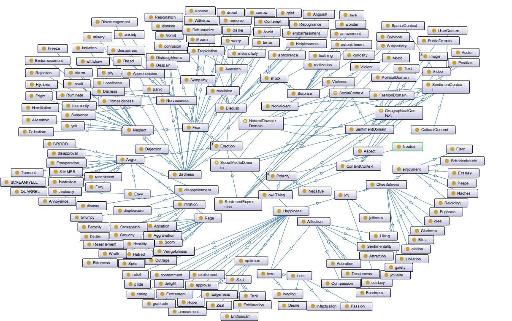
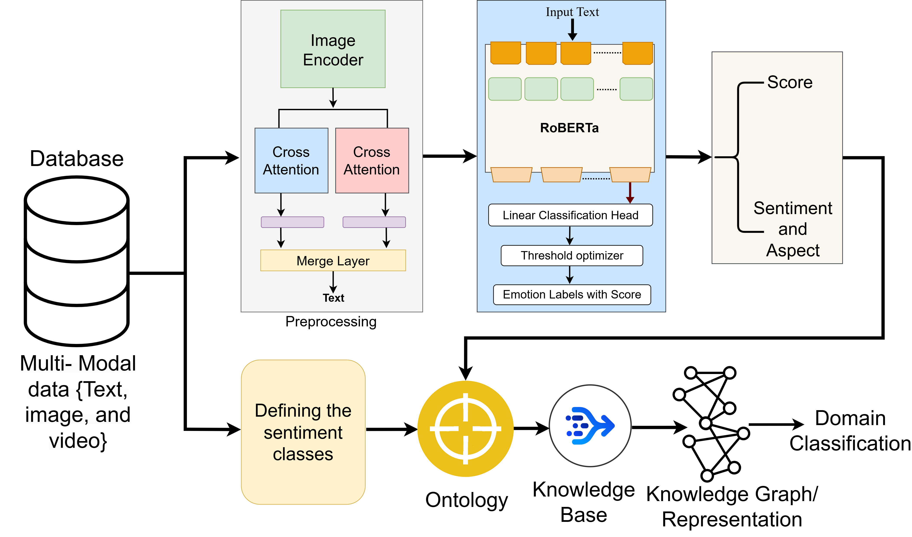
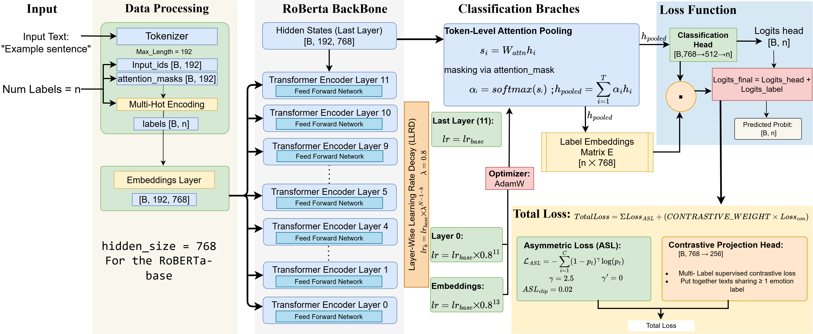

# TriSAO-Tri-Semantic-Aspect-Sentiment-Ontology-

An ontology is a formal specification of a conceptualization, consisting of a defined vocabulary and explicit interpretations of the meanings of the terms within that vocabulary. It involves the identification of the fundamental categories within a given domain, the specification of the relationships between members of these categories, and the definition of constraints that govern the permissible use of these relationships. In the context of sentiment analysis, an ontology represents a structured knowledge framework that formally defines concepts, relationships, and semantic properties related to emotions, opinions, and sentiments expressed in textual data. Unlike traditional sentiment analysis approaches that rely solely on statistical methods, ontology based sentiment analysis provides a knowledge driven foundation that enhances the understanding of context dependent emotions and enables more domain specific sentiment classification. To achieve a complete representation of sentiments and classify their associated domains, this work proposes TriSAO, and the maninly classes are deifned form the [Atlas of Emotions](https://atlasofemotions.org/), which is designed for three main tasks, namely:

1. Classifying sentiments in multi-modal data is challenging due to the complexity of scenarios captured in images or expressed in text, particularly in diverse online contexts. The proposed ontology assists in defining the background and domain, thereby improving the accuracy of sentiment classification.  
2. Sentiment analysis of multi-modal data typically provides only the emotion or opinion associated with an image or text (e.g., online reviews). However, understanding the underlying aspect that triggers this sentiment is equally important. The TriSAO ontology addresses this by explicitly modelling the aspect behind the sentiment.  
3. Comparing and differentiating between the domains of multi-modal data requires semantic similarity analysis to determine the degree of relatedness or difference. The proposed ontology enables this process by providing a similarity score that reflects the semantic closeness of multi-modal content.
---
The Proposed TriSAO Ontology classes are shown below using OntoGraf:

The proposed architecture is shown in the figure below:

---
The proposed RoBERTa model for the sentiment analysis architecture is shown below:

## Citation
If you find this repo useful, please cite our paper.

@article{PANDEY2026133635,
title = {TriSAO: A Multimedia ontology for Cross-Domain Classification through Sentiment and Semantic Similarity Analysis},
journal = {Expert Systems with Applications},
author = {Sourav Pandey and Akanksha Priya and Ashish Singh Patel},
pages = {133635},
year = {2026},
issn = {0957-4174},
doi = {https://doi.org/10.1016/j.eswa.2026.133635},
url = {https://www.sciencedirect.com/science/article/pii/S0957417426025431},
}
